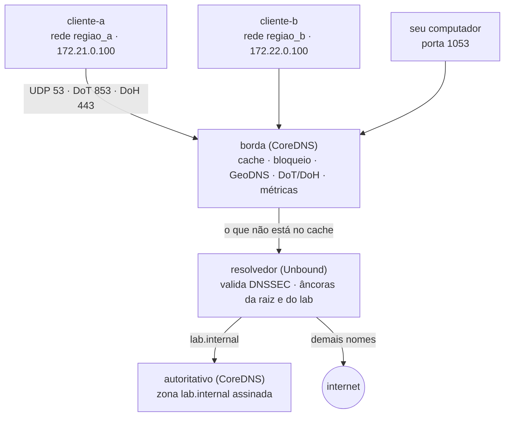
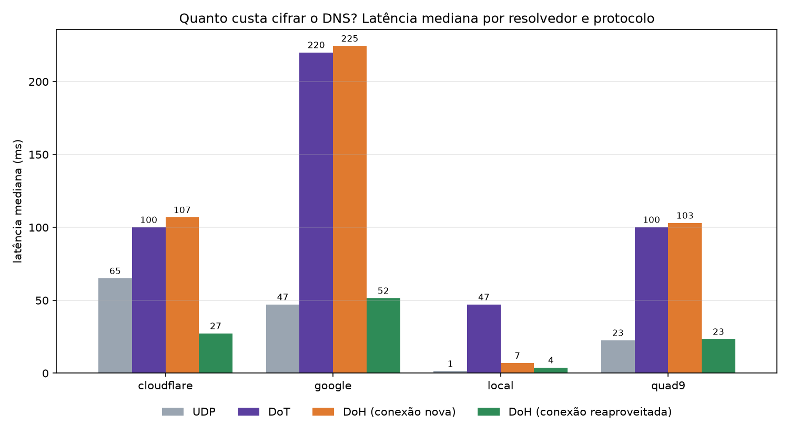
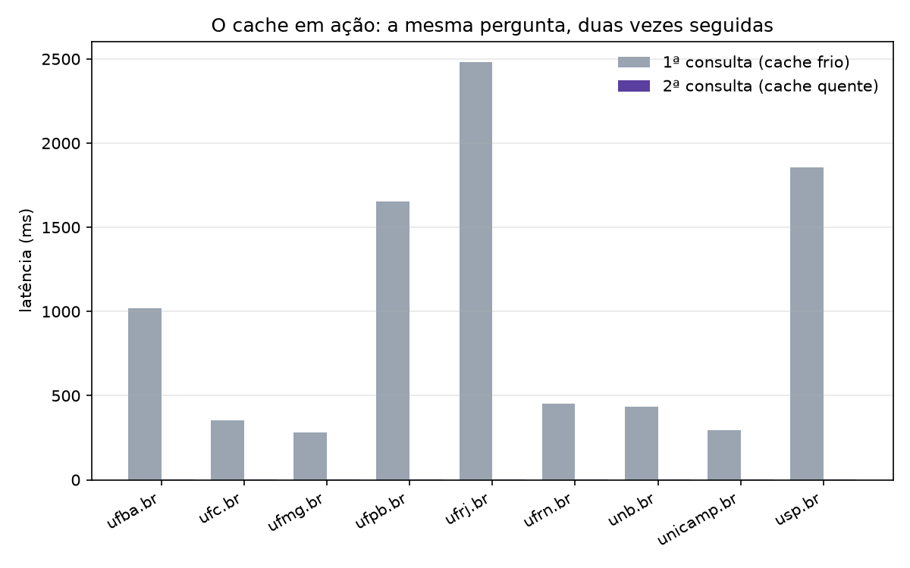

# Laboratório DNS Moderno

Um mini provedor de DNS em Docker que mostra, funcionando, os conceitos do seminário **DNS Moderno**: DNSSEC, envenenamento de cache, DNS over TLS (DoT), DNS over HTTPS (DoH), DNS protetivo, cache, GeoDNS e anycast.

**Disciplina:** Tópicos em Redes de Computadores, Ciência da Computação, UFAL Campus Arapiraca
**Autora:** Jamily Barbosa de Oliveira
**Vídeo de apresentação:** _(coloque aqui o link do YouTube)_

---

## O que o projeto demonstra

| Conceito | Como aparece no laboratório |
| --- | --- |
| **DNSSEC** | Uma zona própria (`lab.internal`) assinada. Se alguém altera uma resposta, o resolvedor detecta e devolve `SERVFAIL`. |
| **Cadeia de confiança** | O resolvedor só aceita a zona porque tem a âncora dela (`lab.ds`), assim como confia na raiz da internet pela KSK-2024. |
| **Envenenamento de cache** | Captura mostrando ID e porta de origem aleatórios, e um script que calcula quantas tentativas um atacante precisaria. |
| **DoT e DoH** | A mesma consulta por UDP, DoT e DoH. Na captura, o nome aparece em texto puro só no UDP. |
| **DNS protetivo** | Uma lista de bloqueio que vale para os três protocolos, e o limite dela: quem pergunta a outro resolvedor escapa. |
| **Cache** | A mesma pergunta duas vezes: a segunda vem da memória e é bem mais rápida. |
| **GeoDNS** | O mesmo nome devolve IPs diferentes para clientes de redes diferentes, utilizando o plugin `view` do CoreDNS. O ECS (EDNS Client Subnet), definido na RFC 7871, permite compartilhar parte do prefixo de rede do cliente para auxiliar na escolha de respostas geograficamente próximas, como servidores de CDNs. Esse mecanismo possui implicações de privacidade, pois expõe informações sobre a rede do cliente. O laboratório não implementa ECS; utiliza o `view` com base no IP de origem. |
| **Anycast** | Medição contra 1.1.1.1, 8.8.8.8 e 9.9.9.9 e descoberta de qual data center respondeu. |

## Arquitetura



| Contêiner | IP | Papel |
| --- | --- | --- |
| `autoritativo` | 172.20.0.10 | Publica a zona `lab.internal` assinada com DNSSEC |
| `resolvedor` | 172.20.0.20 | Unbound: busca as respostas e confere as assinaturas |
| `borda` | 172.20.0.53 / 172.21.0.53 / 172.22.0.53 | CoreDNS: porta de entrada dos clientes |
| `cliente-a` | 172.21.0.100 | Máquina de teste da "região A" (dig, kdig, tcpdump, Python) |
| `cliente-b` | 172.22.0.100 | Máquina de teste da "região B" |

## Requisitos

- [Docker Desktop](https://www.docker.com/products/docker-desktop/) (Windows ou macOS) ou Docker Engine com Compose (Linux)
- Uns 2 GB livres de disco
- [Wireshark](https://www.wireshark.org/) (opcional, para abrir as capturas)

## Como rodar

```bash
# 1. Baixar o projeto
git clone https://github.com/lightnvrr/lab-dns-moderno.git
cd lab-dns-moderno

# 2. Construir as imagens (só na primeira vez, demora alguns minutos)
docker compose build

# 3. Assinar a zona e gerar o certificado do DoT/DoH (só na primeira vez)
docker compose run --rm cliente-a bash /lab/scripts/preparar.sh

# 4. Subir tudo
docker compose up -d
docker compose ps
```

Os comandos funcionam no PowerShell, no Git Bash e no terminal do Linux ou macOS.

## Demonstração completa

```bash
docker compose exec cliente-a bash /lab/scripts/demo.sh
```

O script percorre todos os conceitos, mostrando cada comando antes de rodar e esperando Enter entre as etapas. Para repetir do zero: `docker compose restart borda resolvedor`.

## Demonstrações uma a uma

Entre no cliente com `docker compose exec cliente-a bash` e rode:

**DNSSEC funcionando** (procure a flag `ad` e o `RRSIG`)
```bash
dig @172.21.0.53 www.lab.internal +dnssec
```

**Resposta adulterada vira SERVFAIL**
```bash
bash /lab/scripts/quebrar_zona.sh          # troca o IP de banco.lab.internal sem reassinar
sleep 7
dig @172.21.0.53 banco.lab.internal +dnssec   # status: SERVFAIL
dig @172.21.0.53 banco.lab.internal +cd       # sem validação: aparece o IP falso 10.6.6.6
bash /lab/scripts/restaurar_zona.sh        # reassina e volta ao normal
```
O motivo aparece no log do resolvedor: `docker compose logs resolvedor | grep "validation failure"`.

**Cadeia de confiança na internet real**
```bash
delv @172.21.0.53 registro.br +vtrace       # termina com "fully validated"
```

**DoT e DoH**
```bash
dig @172.21.0.53 +tls   www.lab.internal
dig @172.21.0.53 +https www.lab.internal
```
As capturas de cada protocolo ficam em `capturas/` depois do `demo.sh` e podem ser abertas no Wireshark.

**ID e porta aleatórios (defesa contra envenenamento)**
```bash
# no computador, num terminal:
docker compose exec resolvedor tcpdump -i eth0 -w /capturas/resolvedor.pcap udp port 53
# no cliente-a, noutro terminal:
for i in $(seq 1 20); do dig @172.21.0.53 teste$i.ufal.br +short; done
python3 /lab/medicao/chance_envenenamento.py
```
No Wireshark, filtre por `ip.src == 172.20.0.20 && dns.flags.response == 0` e adicione as colunas `dns.id` e `udp.srcport`. Os nomes saem com maiúsculas e minúsculas misturadas (técnica 0x20).

**DNS protetivo**
```bash
dig @172.21.0.53 doubleclick.net +short     # 0.0.0.0 (bloqueado)
dig @1.1.1.1     doubleclick.net +short     # outro resolvedor: o bloqueio não vale
```
A lista fica em `borda/bloqueio.hosts` e é relida a cada 2 segundos.

**GeoDNS**
```bash
docker compose exec cliente-a dig @172.21.0.53 cdn.geo.internal +short   # 10.1.0.10
docker compose exec cliente-b dig @172.22.0.53 cdn.geo.internal +short   # 10.2.0.10
```

**Anycast**
```bash
dig @1.1.1.1 id.server CH TXT +short
dig @9.9.9.9 id.server CH TXT +short
```

## Medição de desempenho

```bash
docker compose restart borda resolvedor           # esvazia os caches
docker compose exec cliente-a python3 /lab/medicao/medir.py
docker compose exec cliente-a python3 /lab/medicao/analisar.py
```

O `medir.py` faz 2.400 consultas (4 resolvedores × UDP, DoT, DoH com conexão nova e DoH com conexão reaproveitada × 5 nomes × 30 rodadas) e um teste de cache frio x quente. Leva uns 15 minutos. O `analisar.py` gera `medicao/dados/resumo.csv` e os gráficos abaixo.

## Resultados

_(Depois de rodar a medição, suba a pasta `medicao/dados` e escreva aqui, em poucas linhas, o que você observou: quanto o DoT e o DoH custam a mais que o UDP, o efeito de reaproveitar a conexão, a diferença entre cache frio e quente e qual resolvedor público foi mais rápido daqui.)_





## Estrutura

```text
lab-dns-moderno/
├── docker-compose.yml
├── autoritativo/        CoreDNS autoritativo + zona lab.internal
├── resolvedor/          Unbound validador (configuração e âncora da raiz)
├── borda/               CoreDNS de entrada (Corefile e lista de bloqueio)
├── cliente/             Imagem dos clientes de teste
├── scripts/             preparar, assinar, quebrar, restaurar e demo
├── medicao/             scripts de medição e análise, e os dados gerados
└── capturas/            arquivos .pcap gerados nas demonstrações
```

As chaves privadas da zona e do certificado não vão para o repositório (veja o `.gitignore`): cada pessoa gera as suas com o `preparar.sh`.

## Problemas comuns

| Sintoma | O que fazer |
| --- | --- |
| "address already in use" ao subir | Outro programa usa a porta 853, 8443 ou 1053. Troque o número da esquerda em `ports` no `docker-compose.yml`. |
| `resolvedor` ou `borda` aparecem como "Exited" no `docker compose ps` | Faltou rodar o `preparar.sh` antes do `up` (não existem `resolvedor/lab.ds` e `borda/certs/*.pem`). Rode e depois `docker compose up -d`. |
| `SERVFAIL` em tudo de `lab.internal` | Rode de novo o `preparar.sh` e `docker compose restart`. |
| Quebrei a zona mas a resposta continua certa | O nome já estava no cache. `docker compose restart borda resolvedor` e tente de novo. |
| `$'\r': command not found` nos scripts | O Git converteu os finais de linha no Windows. Rode `git config core.autocrlf false` e clone de novo. |
| Muitas falhas nos resolvedores públicos | A rede bloqueia DNS externo ou a porta 853. Teste em outra rede e registre isso nos resultados. |

## Referências

- [CoreDNS: plugins](https://coredns.io/plugins/) (file, view, hosts, template, tls, cache, forward, prometheus)
- [Documentação do Unbound](https://unbound.docs.nlnetlabs.nl/)
- [dnspython](https://dnspython.readthedocs.io/)
- [RFC 4033: DNSSEC](https://www.rfc-editor.org/rfc/rfc4033) · [RFC 7858: DoT](https://www.rfc-editor.org/rfc/rfc7858) · [RFC 8484: DoH](https://www.rfc-editor.org/rfc/rfc8484) · [RFC 7871: EDNS Client Subnet](https://www.rfc-editor.org/rfc/rfc7871)
