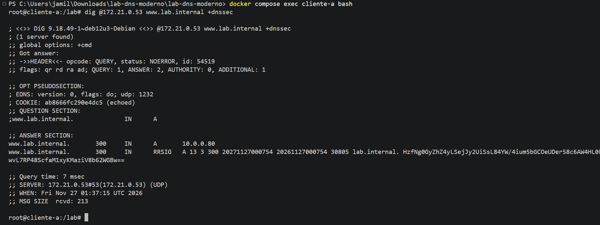
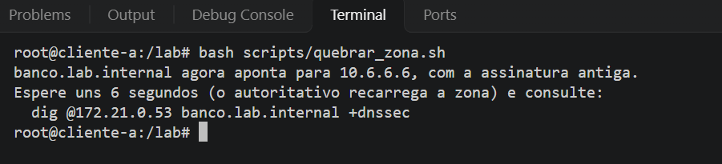
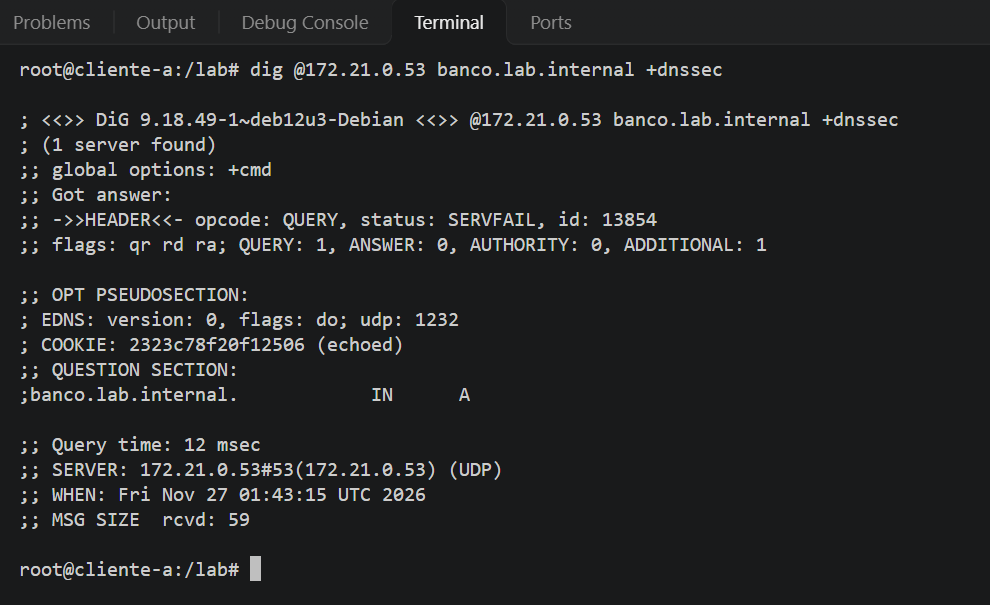
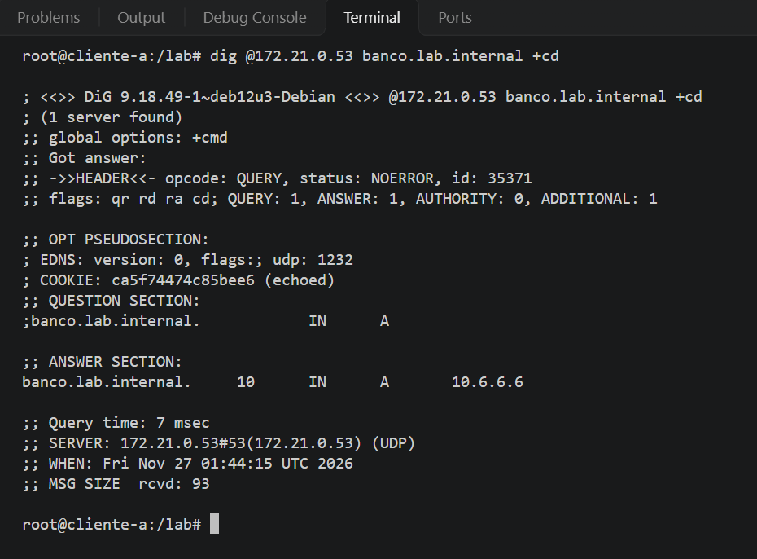
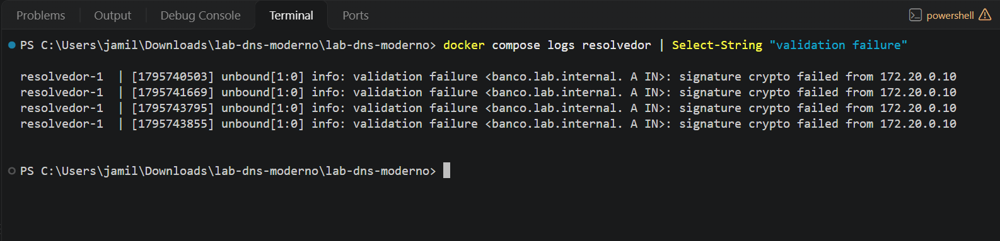
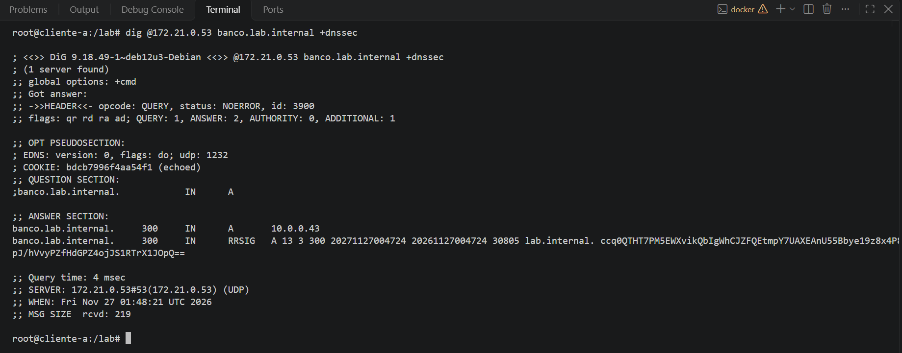

# Issue #2: Módulo 1, DNSSEC, zona assinada e quebra proposital

Máquina: Windows 11 Home, PowerShell, Docker Desktop 29.9.3.
Data: 27/11/2026 (horário dos contêineres em UTC).
Laboratório no ar desde a issue #1, com os cinco contêineres `running`.

Todos os comandos abaixo foram rodados do PowerShell com `docker compose exec -T cliente-a ...`.
Dentro do cliente (`docker compose exec cliente-a bash`) basta digitar a parte depois de `cliente-a`.

## 1. Consulta assinada: flag `ad` e RRSIG

```powershell
docker compose exec -T cliente-a dig "@172.21.0.53" www.lab.internal +dnssec
```

```
; <<>> DiG 9.18.49-1~deb12u3-Debian <<>> @172.21.0.53 www.lab.internal +dnssec
; (1 server found)
;; global options: +cmd
;; Got answer:
;; ->>HEADER<<- opcode: QUERY, status: NOERROR, id: 47531
;; flags: qr aa rd ra ad; QUERY: 1, ANSWER: 2, AUTHORITY: 0, ADDITIONAL: 1

;; OPT PSEUDOSECTION:
; EDNS: version: 0, flags: do; udp: 1232
; COOKIE: 32cf1f081b41885b (echoed)
;; QUESTION SECTION:
;www.lab.internal.		IN	A

;; ANSWER SECTION:
www.lab.internal.	27	IN	A	10.0.0.80
www.lab.internal.	27	IN	RRSIG	A 13 3 300 20271126234257 20261126234257 30805 lab.internal. N03D9M/1XqNIWXO5MTmjDC8D4Cm4Gygd6+LCqw/gU3CjhDzp5k1ScA20 McCzA3o+/8dm6Ak4fyEa7WmxGmtG4w==

;; Query time: 0 msec
;; SERVER: 172.21.0.53#53(172.21.0.53) (UDP)
;; WHEN: Fri Nov 27 00:48:04 UTC 2026
;; MSG SIZE  rcvd: 213
```

A resposta traz o registro `A` (10.0.0.80) e, junto, o `RRSIG`, que é a assinatura digital
desse registro. Lendo o RRSIG: algoritmo `13` (ECDSA P-256), `3` rótulos no nome, validade de
26/11/2026 a 26/11/2027, assinado pela chave de tag `30805` (a ZSK) da zona `lab.internal`.
A flag `ad` (Authenticated Data) mostra que o resolvedor conferiu a assinatura e ela bateu.
O TTL 27 (e não 300) indica que a resposta veio do cache da borda, preenchido no teste da issue #1.

Para ter um "antes" do ataque, consultei também o nome que vai ser adulterado:

```powershell
docker compose exec -T cliente-a dig "@172.21.0.53" banco.lab.internal +dnssec +noall +comments +answer
```

```
;; Got answer:
;; ->>HEADER<<- opcode: QUERY, status: NOERROR, id: 63573
;; flags: qr rd ra ad; QUERY: 1, ANSWER: 2, AUTHORITY: 0, ADDITIONAL: 1

;; OPT PSEUDOSECTION:
; EDNS: version: 0, flags: do; udp: 1232
; COOKIE: 22002f495f232273 (echoed)
;; ANSWER SECTION:
banco.lab.internal.	300	IN	A	10.0.0.43
banco.lab.internal.	300	IN	RRSIG	A 13 3 300 20271126234257 20261126234257 30805 lab.internal. dZYjNT8BPpCY9jhIk5VpweDIxDv+ltXnJCCcqe8sC0dyb3wjfYEbf8vl lbLZmd4aLv0plttg3nM3ZWNNxofx+w==
```

O endereço verdadeiro do banco é **10.0.0.43**, validado (`ad`).

## 2. `quebrar_zona.sh` e SERVFAIL em `banco.lab.internal`

```powershell
docker compose exec -T cliente-a bash /lab/scripts/quebrar_zona.sh
```

```
banco.lab.internal agora aponta para 10.6.6.6, com a assinatura antiga.
Espere uns 6 segundos (o autoritativo recarrega a zona) e consulte:
  dig @172.21.0.53 banco.lab.internal +dnssec
```

Conferindo o que mudou no arquivo publicado pelo autoritativo:

```powershell
docker compose exec -T cliente-a bash -c "grep -n -E 'banco|; serial' /lab/autoritativo/zonas/db.lab.internal.signed | head"
```

```
4:					1795740178 ; serial
27:			300	NSEC	banco.lab.internal. NS SOA MX RRSIG NSEC DNSKEY
65:banco.lab.internal.	300	IN A	10.6.6.6
```

O script fez o papel do atacante: trocou o IP do banco por 10.6.6.6 direto no arquivo assinado,
sem refazer a assinatura, e subiu o serial para o autoritativo recarregar a zona.

Como a resposta verdadeira tinha acabado de ser guardada no cache (TTL 300), esvaziei os caches
antes de consultar, como manda a seção "Problemas comuns" do README:

```powershell
docker compose restart borda resolvedor
```

Depois de 8 segundos:

```powershell
docker compose exec -T cliente-a dig "@172.21.0.53" banco.lab.internal +dnssec
```

```
; <<>> DiG 9.18.49-1~deb12u3-Debian <<>> @172.21.0.53 banco.lab.internal +dnssec
; (1 server found)
;; global options: +cmd
;; Got answer:
;; ->>HEADER<<- opcode: QUERY, status: SERVFAIL, id: 7164
;; flags: qr rd ra; QUERY: 1, ANSWER: 0, AUTHORITY: 0, ADDITIONAL: 1

;; OPT PSEUDOSECTION:
; EDNS: version: 0, flags: do; udp: 1232
; COOKIE: 35ca4aaf75c75cff (echoed)
;; QUESTION SECTION:
;banco.lab.internal.		IN	A

;; Query time: 7 msec
;; SERVER: 172.21.0.53#53(172.21.0.53) (UDP)
;; WHEN: Fri Nov 27 00:48:23 UTC 2026
;; MSG SIZE  rcvd: 59
```

O status virou `SERVFAIL` e a seção de resposta está vazia (`ANSWER: 0`). O resolvedor
percebeu que a assinatura não confere com o IP novo e **preferiu não responder** a entregar
um endereço falso. Para o cliente, é melhor um erro do que ser levado ao servidor do atacante.

## 3. `+cd` mostra o IP falso 10.6.6.6

```powershell
docker compose exec -T cliente-a dig "@172.21.0.53" banco.lab.internal +cd
```

```
; <<>> DiG 9.18.49-1~deb12u3-Debian <<>> @172.21.0.53 banco.lab.internal +cd
; (1 server found)
;; global options: +cmd
;; Got answer:
;; ->>HEADER<<- opcode: QUERY, status: NOERROR, id: 4781
;; flags: qr rd ra cd; QUERY: 1, ANSWER: 1, AUTHORITY: 0, ADDITIONAL: 1

;; OPT PSEUDOSECTION:
; EDNS: version: 0, flags:; udp: 1232
; COOKIE: b2e69692950f0307 (echoed)
;; QUESTION SECTION:
;banco.lab.internal.		IN	A

;; ANSWER SECTION:
banco.lab.internal.	9	IN	A	10.6.6.6

;; Query time: 3 msec
;; SERVER: 172.21.0.53#53(172.21.0.53) (UDP)
;; WHEN: Fri Nov 27 00:48:24 UTC 2026
;; MSG SIZE  rcvd: 93
```

A opção `+cd` (Checking Disabled) pede ao resolvedor "não valide, me entregue o que veio".
Aí aparece o IP adulterado **10.6.6.6**, sem a flag `ad`. Isso prova que o SERVFAIL anterior
foi uma decisão do DNSSEC, e não uma falha de rede. O TTL 9 vem do `val-bogus-ttl: 10` do
`unbound.conf`: respostas inválidas ficam guardadas só 10 segundos.

## 4. Log do resolvedor com `validation failure`

```powershell
docker compose logs --no-color resolvedor | Select-String "validation failure|SERVFAIL"
```

```
resolvedor-1  | [1795740503] unbound[1:0] info: validation failure <banco.lab.internal. A IN>: signature crypto failed from 172.20.0.10
```

O Unbound registra o motivo exato: para o registro `A` de `banco.lab.internal`, a conta
criptográfica da assinatura falhou (`signature crypto failed`) na resposta vinda de
172.20.0.10, que é o autoritativo. Ou seja, o dado foi alterado depois de assinado.

## 5. `restaurar_zona.sh` e a flag `ad` de volta

```powershell
docker compose exec -T cliente-a bash /lab/scripts/restaurar_zona.sh
```

```
Zona reassinada. Em uns 15 segundos (recarga da zona + cache da resposta inválida)
banco.lab.internal volta a responder 10.0.0.43 com a flag ad.
```

Depois de 16 segundos:

```powershell
docker compose exec -T cliente-a dig "@172.21.0.53" banco.lab.internal +dnssec
```

```
; <<>> DiG 9.18.49-1~deb12u3-Debian <<>> @172.21.0.53 banco.lab.internal +dnssec
; (1 server found)
;; global options: +cmd
;; Got answer:
;; ->>HEADER<<- opcode: QUERY, status: NOERROR, id: 7929
;; flags: qr rd ra ad; QUERY: 1, ANSWER: 2, AUTHORITY: 0, ADDITIONAL: 1

;; OPT PSEUDOSECTION:
; EDNS: version: 0, flags: do; udp: 1232
; COOKIE: 0ac24c59ea460429 (echoed)
;; QUESTION SECTION:
;banco.lab.internal.		IN	A

;; ANSWER SECTION:
banco.lab.internal.	300	IN	A	10.0.0.43
banco.lab.internal.	300	IN	RRSIG	A 13 3 300 20271126234833 20261126234833 30805 lab.internal. /1gN+tg8LpswKFB9I3DGM7S48Hu67q6beI+A6aoCSI/Uc5s+LozxrUGI b+YA4DLwyMA2U/PCzN206ZtPNFJlWw==

;; Query time: 3 msec
;; SERVER: 172.21.0.53#53(172.21.0.53) (UDP)
;; WHEN: Fri Nov 27 00:48:49 UTC 2026
;; MSG SIZE  rcvd: 219
```

```powershell
docker compose exec -T cliente-a bash -c "grep -n -E '^banco|; serial' /lab/autoritativo/zonas/db.lab.internal.signed"
```

```
4:					1795740513 ; serial
65:banco.lab.internal.	300	IN A	10.0.0.43
```

A zona foi assinada de novo a partir do arquivo original: o banco voltou a 10.0.0.43 e a flag
`ad` voltou. O RRSIG é novo (início 20261126234833, antes era 20261126234257), mas a chave
continua a mesma (tag 30805), porque o script reaproveita as chaves que já existem. Por isso
a âncora `lab.ds` do resolvedor não precisou mudar.

## 6. Prints para o README e o vídeo

Prints tirados pela Jamily numa sessão própria, entre 01:37 e 01:48 UTC de 27/11/2026,
repetindo as etapas acima.

### Print 1: resposta validada



*Antes do ataque: `www.lab.internal` responde 10.0.0.80 com a flag **`ad`** e o **`RRSIG`**,
assinado pela chave 30805 da zona `lab.internal`.*

### Print 2: o ataque



*O `quebrar_zona.sh` troca o IP de `banco.lab.internal` para **10.6.6.6** direto na zona
publicada, mas mantém a assinatura antiga, porque o atacante não tem a chave privada.*

### Print 3: a defesa



*O resolvedor confere a assinatura, ela não bate com o IP novo, e a resposta vira
**`status: SERVFAIL`** com **`ANSWER: 0`**. É melhor não responder do que entregar um endereço falso.*

### Print 4: a prova



*Com `+cd` (sem validação), aparece o IP falso **10.6.6.6**. A flag agora é **`cd`** (Checking
Disabled), e não `ad`, porque a resposta não foi validada. O TTL é **10**, e não 300, por causa
do `val-bogus-ttl: 10` do `unbound.conf`: uma resposta inválida fica guardada só 10 segundos.*

### Print 5: o motivo, no log do resolvedor



*O Unbound registra `validation failure <banco.lab.internal. A IN>: signature crypto failed
from 172.20.0.10`, que é o autoritativo. As **duas últimas linhas são desta sessão**: os carimbos
1795743795 e 1795743855 são 01:43:15 e 01:44:15 UTC, os mesmos horários dos prints 3 e 4. As
duas primeiras são de testes anteriores: 1795740503 (00:48:23) é a quebra das seções 2 a 4 e
1795741669 (01:07:49) é o teste por DoH da issue #6.*

### Print 6: de volta ao normal



*Depois do `restaurar_zona.sh`, o banco volta a **10.0.0.43** com **`ad`**. O RRSIG tem
**datas novas** (20261127004724 a 20271127004724) porque a zona foi **reassinada**, mas com a
**mesma chave 30805**. Por isso a âncora `lab.ds` do resolvedor continua valendo.*

### Para repetir na gravação

Dentro de `docker compose exec cliente-a bash`:

```bash
dig @172.21.0.53 www.lab.internal +dnssec        # print 1
bash /lab/scripts/quebrar_zona.sh                # print 2
sleep 7
dig @172.21.0.53 banco.lab.internal +dnssec      # print 3
dig @172.21.0.53 banco.lab.internal +cd          # print 4
```

Se o `banco.lab.internal` tiver sido consultado nos 5 minutos anteriores, a resposta verdadeira
ainda está no cache. Nesse caso, rode no PowerShell `docker compose restart borda resolvedor`
antes do print 3. No PowerShell, para o print 5:
`docker compose logs resolvedor | Select-String "validation failure"`. Depois:

```bash
bash /lab/scripts/restaurar_zona.sh
sleep 16
dig @172.21.0.53 banco.lab.internal +dnssec      # print 6
```

## Resumo

| Item do checklist | Situação |
| --- | --- |
| `dig www.lab.internal +dnssec` com `ad` e RRSIG | Ok |
| `quebrar_zona.sh` e SERVFAIL no banco | Ok |
| `+cd` mostrando 10.6.6.6 | Ok |
| Log com `validation failure` | Ok |
| `restaurar_zona.sh` e `ad` de volta | Ok |
| Prints para o README e o vídeo | Ok, 6 prints na seção 6 |
