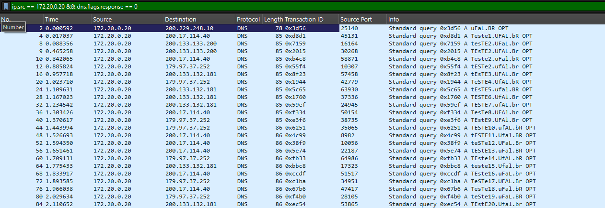

# Issue #5: Módulo 3, envenenamento de cache (captura e conta)

Máquina: Windows 11 Home, PowerShell, Docker Desktop 29.9.3.
Data: 27/11/2026 (horário dos contêineres em UTC).

## Como o ataque funciona (para ler antes das saídas)

Quando o resolvedor pergunta algo a um servidor na internet, ele aceita a primeira resposta
que chegar com os dados certos: o mesmo **ID** de 16 bits da pergunta, a mesma **porta**
de origem e o mesmo **nome**. Um atacante que não vê o tráfego pode tentar mandar respostas
falsas antes da verdadeira, chutando esses valores. Se acertar, a mentira fica no cache e é
entregue a todos os clientes até o TTL acabar. Isso é o **envenenamento de cache**.

As defesas que o laboratório mostra são todas formas de aumentar o que o atacante precisa adivinhar:

| Defesa | O que o atacante precisa acertar |
| --- | --- |
| ID aleatório | 1 em 65.536 (16 bits) |
| + porta de origem aleatória | 1 em cerca de 4 bilhões (cerca de 32 bits) |
| + 0x20 (maiúsculas e minúsculas) | mais 1 bit por letra do nome |
| DNSSEC (só em zonas assinadas) | não adianta acertar: a resposta falsa não tem assinatura válida (issue #2). Em zonas sem DNSSEC, valem só as linhas de cima |

## 1. Captura do resolvedor com `tcpdump`

O README manda rodar o `tcpdump` num terminal e as consultas em outro. Fiz o mesmo, mas com
o `tcpdump` em segundo plano (`-d`), parando com `kill -INT`, que é o equivalente ao `Ctrl+C`.

```powershell
docker compose exec -d resolvedor tcpdump -i eth0 -w /capturas/resolvedor.pcap udp port 53
docker compose exec -T cliente-a bash -c 'for i in $(seq 1 20); do dig @172.21.0.53 teste$i.ufal.br +short; done'
docker compose exec -T resolvedor bash -c 'kill -INT $(pidof tcpdump)'
```

Os nomes `testeN.ufal.br` não existem, então o `dig +short` não imprime nada (NXDOMAIN). O
objetivo é só obrigar o resolvedor a perguntar 20 nomes novos à internet.

Conferindo que o `tcpdump` parou e o tamanho da captura:

```powershell
docker compose exec -T resolvedor pidof tcpdump      # sem saída e código 1: nenhum tcpdump rodando
Get-ChildItem capturas/resolvedor.pcap
docker compose exec -T cliente-a tcpdump -r /lab/capturas/resolvedor.pcap -n | Measure-Object -Line
```

```
Name            Length
----            ------
resolvedor.pcap  11283

86
```

A captura tem 86 pacotes (perguntas e respostas entre cliente, borda, resolvedor, autoritativo
e internet). O arquivo `capturas/resolvedor.pcap` fica só na sua máquina, porque o
`.gitignore` não deixa `.pcap` ir para o GitHub.

### As perguntas que o resolvedor mandou para a internet

O `cliente-a` não tem Wireshark, mas o `tcpdump` também lê o arquivo. Este é o mesmo filtro
que o README sugere para o Wireshark (`ip.src == 172.20.0.20 && dns.flags.response == 0`):

```powershell
docker compose exec -T cliente-a tcpdump -r /lab/capturas/resolvedor.pcap -n -tttt src host 172.20.0.20 and dst port 53
```

```
2026-11-27 01:02:01.859923 IP 172.20.0.20.25140 > 200.229.248.10.53: 15702% [1au] A? uFaL.BR. (36)
2026-11-27 01:02:01.876368 IP 172.20.0.20.45131 > 200.17.114.40.53: 55505% [1au] A? Teste1.UFAL.bR. (43)
2026-11-27 01:02:01.947687 IP 172.20.0.20.16164 > 200.133.133.200.53: 29017% [1au] A? tesTE2.UFaL.br. (43)
2026-11-27 01:02:02.324589 IP 172.20.0.20.30268 > 200.133.133.200.53: 8213% [1au] A? TEsTE2.UFAL.Br. (43)
2026-11-27 01:02:02.701396 IP 172.20.0.20.58871 > 200.17.114.40.53: 46280% [1au] A? Teste2.uFal.bR. (43)
2026-11-27 01:02:02.745155 IP 172.20.0.20.10307 > 179.97.37.252.53: 22004% [1au] A? tESTe2.ufAl.br. (43)
2026-11-27 01:02:02.817049 IP 172.20.0.20.57458 > 200.133.132.181.53: 36643% [1au] A? tEsTE3.UFAL.Br. (43)
2026-11-27 01:02:02.883041 IP 172.20.0.20.42779 > 179.97.37.252.53: 6468% [1au] A? TeSTE4.UfAL.bR. (43)
2026-11-27 01:02:02.968962 IP 172.20.0.20.63930 > 200.133.132.181.53: 23653% [1au] A? tEsTE5.ufal.BR. (43)
2026-11-27 01:02:03.026354 IP 172.20.0.20.37336 > 200.133.132.181.53: 5984% [1au] A? TESTE6.UfAl.Br. (43)
2026-11-27 01:02:03.093873 IP 172.20.0.20.24945 > 200.133.132.181.53: 23023% [1au] A? TESTE7.ufAL.br. (43)
2026-11-27 01:02:03.162757 IP 172.20.0.20.50154 > 200.17.114.40.53: 62260% [1au] A? TesTe8.UFAl.br. (43)
2026-11-27 01:02:03.229948 IP 172.20.0.20.38735 > 179.97.37.252.53: 58358% [1au] A? TEstE9.UFAl.Br. (43)
2026-11-27 01:02:03.303325 IP 172.20.0.20.35065 > 179.97.37.252.53: 25169% [1au] A? TESTE10.ufAL.bR. (44)
2026-11-27 01:02:03.386024 IP 172.20.0.20.8982 > 200.17.114.40.53: 19609% [1au] A? tESTE11.Ufal.BR. (44)
2026-11-27 01:02:03.453681 IP 172.20.0.20.10056 > 200.17.114.40.53: 14585% [1au] A? teSTe12.UFaL.Br. (44)
2026-11-27 01:02:03.510792 IP 172.20.0.20.22187 > 200.17.114.40.53: 24180% [1au] A? tEStE13.uFal.BR. (44)
2026-11-27 01:02:03.568462 IP 172.20.0.20.64986 > 179.97.37.252.53: 64307% [1au] A? TEste14.UfAL.bR. (44)
2026-11-27 01:02:03.634764 IP 172.20.0.20.17323 > 200.133.132.181.53: 48072% [1au] A? teste15.Ufal.br. (44)
2026-11-27 01:02:03.693248 IP 172.20.0.20.51517 > 200.17.114.40.53: 52447% [1au] A? TEste16.uFaL.br. (44)
2026-11-27 01:02:03.752916 IP 172.20.0.20.34951 > 179.97.37.252.53: 49594% [1au] A? TeSTe17.UFAL.Br. (44)
2026-11-27 01:02:03.825369 IP 172.20.0.20.47417 > 200.17.114.40.53: 26550% [1au] A? TesTe18.uFal.bR. (44)
2026-11-27 01:02:03.888965 IP 172.20.0.20.28105 > 179.97.37.252.53: 62640% [1au] A? teSte19.uFaL.BR. (44)
2026-11-27 01:02:03.969983 IP 172.20.0.20.53865 > 200.133.132.181.53: 60500% [1au] A? TEstE20.Ufal.br. (44)
```

Como ler cada linha: `172.20.0.20.25140` é o resolvedor saindo pela **porta 25140**; depois do
`>` vem o servidor de destino na porta 53; `15702` é o **ID**; e `A? uFaL.BR.` é o **nome**
perguntado.

## 2. ID e porta de origem mudando a cada pergunta

Das 24 perguntas acima, **nenhum ID se repete e nenhuma porta se repete**:

- IDs: de 5984 a 64307, sem padrão (15702, 55505, 29017, 8213, 46280...).
- Portas: de 8982 a 64986, também sem padrão (25140, 45131, 16164, 30268, 58871...).

Um resolvedor antigo usaria sempre a mesma porta e IDs em sequência (1, 2, 3...), e o
atacante só teria que chutar perto do último valor. Aqui, a cada pergunta ele teria que acertar
ao mesmo tempo um ID entre 65.536 possíveis e uma porta entre dezenas de milhares.

O `teste2` mostra isso até nas tentativas repetidas: o servidor 200.133.133.200 não respondeu
duas vezes (sem resposta na captura entre 01:02:01.947 e 01:02:02.701), e o resolvedor tentou
de novo com **ID e porta novos** em cada tentativa (29017/16164, 8213/30268, 46280/58871). Ele
ainda mandou uma quarta pergunta, para 179.97.37.252. A captura não mostra o motivo dessa última.

Também dá para ver que o resolvedor não perguntou nada à raiz nem ao `.br` nesse teste, porque
esses dados já estavam no cache desde a issue #3. A primeira pergunta (`uFaL.BR.` para
200.229.248.10, um servidor do `.br`) leva só `ufal.br`, sem o `teste1` na frente: o Unbound
conta ao servidor do `.br` só o pedaço do nome que ele precisa saber (minimização de nome, RFC 7816).

## 3. Nomes com maiúsculas e minúsculas misturadas (0x20)

O cliente perguntou `teste1.ufal.br`, `teste2.ufal.br` e assim por diante, tudo em minúsculas.
Mas o resolvedor mandou `Teste1.UFAL.bR.`, `tesTE2.UFaL.br.`, `TEsTE2.UFAL.Br.`... Isso é o
`use-caps-for-id: yes` do `unbound.conf`, a **técnica 0x20**. O DNS não diferencia maiúsculas
de minúsculas, então a pergunta continua valendo. O nome desse truque vem do bit `0x20` da
tabela ASCII, que é a única diferença entre `A` (0x41) e `a` (0x61).

O que faz isso ser uma defesa é que o servidor **devolve o nome exatamente como recebeu**:

```powershell
docker compose exec -T cliente-a tcpdump -r /lab/capturas/resolvedor.pcap -n -vv src port 53 and dst host 172.20.0.20 and not src host 172.20.0.10 | Select-String -Pattern "q: A\?" | Select-Object -First 6
```

```
    200.229.248.10.53 > 172.20.0.20.25140: [udp sum ok] 15702- q: A? uFaL.BR. 0/6/5 ns: ufal.br. NS ns3.ufal.br., ufal.br. NS ns2.ufal.br., ufal.br. NS ns1.ufal.br., ufal.br. NS ns4.ufal.br., ufal.br. NSEC, ufal.br. RRSIG ar: ns1.ufal.br. A 200.17.114.40, ns2.ufal.br. A 200.133.132.181, ns3.ufal.br. A 200.133.133.200, ns4.ufal.br. A 179.97.37.252, . OPT UDPsize=1232 DO (306)
    200.17.114.40.53 > 172.20.0.20.45131: [udp sum ok] 55505 NXDomain*- q: A? Teste1.UFAL.bR. 0/1/1 ns: ufal.br. SOA ns1.ufal.br. admin.ufal.br. 2026110902 3600 3600 604800 3600 ar: . OPT UDPsize=1232 DO (96)
    200.17.114.40.53 > 172.20.0.20.58871: [udp sum ok] 46280 NXDomain*- q: A? Teste2.uFal.bR. 0/1/1 ns: ufal.br. SOA ns1.ufal.br. admin.ufal.br. 2026110902 3600 3600 604800 3600 ar: . OPT UDPsize=1232 DO (96)
    179.97.37.252.53 > 172.20.0.20.10307: [udp sum ok] 22004 NXDomain* q: A? tESTe2.ufAl.br. 0/1/1 ns: ufal.br. SOA ns1.ufal.br. admin.ufal.br. 2026110902 3600 3600 604800 3600 ar: . OPT UDPsize=1232 DO (96)
    200.133.132.181.53 > 172.20.0.20.57458: [udp sum ok] 36643 NXDomain*- q: A? tEsTE3.UFAL.Br. 0/1/1 ns: ufal.br. SOA ns1.ufal.br. admin.ufal.br. 2026110902 3600 3600 604800 3600 ar: . OPT UDPsize=1232 DO (96)
    179.97.37.252.53 > 172.20.0.20.42779: [udp sum ok] 6468 NXDomain* q: A? TeSTE4.UfAL.bR. 0/1/1 ns: ufal.br. SOA ns1.ufal.br. admin.ufal.br. 2026110902 3600 3600 604800 3600 ar: . OPT UDPsize=1232 DO (96)
```

(As linhas longas foram juntadas, porque o PowerShell as quebrava na largura da tela.)

Cada resposta traz o **mesmo ID, a mesma porta e o mesmo nome**, letra por letra, da pergunta
correspondente: `55505`, porta `45131` e `Teste1.UFAL.bR.`, por exemplo. O atacante, que não vê
a pergunta, teria que adivinhar também essa combinação de letras. `teste1.ufal.br` tem
11 letras (o número não conta), ou seja, mais 11 bits e 2.048 vezes mais combinações.

## 4. Saída do `medicao/chance_envenenamento.py`

```powershell
docker compose exec -T cliente-a python3 /lab/medicao/chance_envenenamento.py
```

```
Atacante com 1000 respostas falsas por tentativa ("corrida"):

Só o ID aleatório (16 bits)
  combinações possíveis:                65.536
  chance por corrida:                0.0152588
  corridas para 50% de chance:              46

ID + porta de origem (cerca de 32 bits)
  combinações possíveis:         4.294.967.296
  chance por corrida:                0.0000002
  corridas para 50% de chance:       2.977.045

Com o truque de Kaminsky (2008), cada nome inventado começa uma corrida nova.
Dezenas de corridas levam segundos; milhões já não. A garantia de verdade vem do DNSSEC.
```

O script não manda nenhum pacote: ele só faz a conta. Supondo que o atacante consegue mandar
1000 respostas falsas antes de a verdadeira chegar, com **só o ID aleatório** a chance por
corrida é de 1000/65.536 (cerca de 1,5%), e bastam **46 corridas** para ter 50% de chance de
sucesso. Com **ID e porta**, a chance cai para 1000/4,3 bilhões, e são precisas quase
**3 milhões de corridas**.

O "truque de Kaminsky" é por que o número de corridas importa: o atacante pede nomes inventados
(`aaa1.banco.com`, `aaa2.banco.com`...), que nunca estão no cache, e assim cada um abre uma
corrida nova na hora, sem esperar TTL nenhum. Foi o que a nossa captura fez, com
`teste1`...`teste20`. O script não inclui o 0x20, que deixaria a conta ainda pior para o
atacante, e lembra que a garantia de verdade vem do DNSSEC: se o domínio é assinado, mesmo
que ele acerte tudo, a resposta falsa não tem assinatura válida. Se o domínio não usa DNSSEC,
a defesa é só a aleatoriedade.

## 5. Wireshark com as colunas `dns.id` e `udp.srcport`



*As 24 perguntas que o resolvedor mandou para a internet (filtro
`ip.src == 172.20.0.20 && dns.flags.response == 0`). As colunas **Transaction ID** e
**Source Port** mudam a cada pergunta, e a coluna **Info** mostra o 0x20 (`Teste1.UFAL.bR`,
`tesTE2.UFaL.br`...). Os quadros **8 e 9** são a nova tentativa para o mesmo servidor
(200.133.133.200), que não respondeu: o mesmo `teste2`, mas com ID e porta diferentes
(`0x7159`/16164 e depois `0x2015`/30268). O Wireshark mostra o ID em hexadecimal:
`0x7159` é o 29017 que o `tcpdump` mostrou na seção 1.*

Como o print foi feito:

1. Abra no Wireshark o arquivo
   `C:\Users\jamil\Downloads\lab-dns-moderno\lab-dns-moderno\capturas\resolvedor.pcap`
   (ele já existe, da captura acima). Se quiser uma captura nova, repita os comandos da seção 1.
2. Na barra de filtro, digite `ip.src == 172.20.0.20 && dns.flags.response == 0` e aperte Enter.
   Devem aparecer as 24 perguntas da lista acima.
3. Para adicionar as colunas: **Edit > Preferences > Appearance > Columns**, clique em **+**,
   escolha o tipo **Custom** e preencha o campo com `dns.id`. Repita com `udp.srcport`. Outra
   forma é abrir um pacote, expandir "Domain Name System", clicar com o botão direito em
   "Transaction ID" e escolher **Apply as Column**. Faça o mesmo com "Source Port", em
   "User Datagram Protocol".
4. Dica: em **View > Time Display Format**, escolha "Seconds Since Previous Displayed Packet".
   Fica claro que as perguntas saem a cada poucos milissegundos, cada uma com ID e porta diferentes.

O print acima cobre os itens 2 e 3 da issue de uma vez. No quadro 4, por exemplo, aparece
`Standard query 0xd8d1 A Teste1.UFAL.bR OPT`, em que `0xd8d1` é o ID 55505 em hexadecimal.
Prints opcionais que não foram feitos: um pacote aberto com "Transaction ID" e "Queries"
expandidos, e a saída do `chance_envenenamento.py` no terminal (o texto já está na seção 4).

## Resumo

| Item do checklist | Situação |
| --- | --- |
| Captura do resolvedor com `tcpdump` | Ok, `capturas/resolvedor.pcap` com 86 pacotes (fica só local) |
| Wireshark com `dns.id` e `udp.srcport` mudando | Ok, print na seção 5, conferido com o `tcpdump -r` (24 IDs e 24 portas diferentes) |
| Nomes com maiúsculas e minúsculas (0x20) | Ok, nas perguntas e ecoados nas respostas |
| Saída do `chance_envenenamento.py` | Ok |

## Como explicar no vídeo

Sugestão de fala, com o print da seção 5 na tela:

> O resolvedor aceita a primeira resposta que chega com o mesmo ID, a mesma porta e o mesmo nome
> da pergunta. Um atacante pode tentar chegar antes da resposta verdadeira, mandando respostas
> falsas e chutando esses valores. Se ele acertar, a mentira fica no cache e vai para todo mundo:
> isso é o **envenenamento de cache**.
>
> Na captura, cada pergunta sai com um ID e uma porta diferentes e sem padrão. Até quando o
> servidor não responde e o resolvedor tenta de novo, nos quadros 8 e 9, os dois mudam. Então o
> atacante teria que acertar uma entre 4 bilhões de combinações.
>
> Além disso, o Unbound mistura maiúsculas e minúsculas no nome, a técnica 0x20, e o servidor
> devolve as letras iguais. É mais uma coisa que o atacante não tem como saber.
>
> O script mostra a diferença: com só o ID aleatório, 46 tentativas bastam para ter 50% de
> chance. Com ID e porta, são quase 3 milhões. A aleatoriedade deixa o ataque muito caro. Mas a
> garantia de verdade vem do DNSSEC: se o domínio é assinado, mesmo acertando tudo o atacante
> não passa, porque a resposta falsa não tem assinatura válida. Se o domínio não usa DNSSEC,
> fica só a aleatoriedade.
