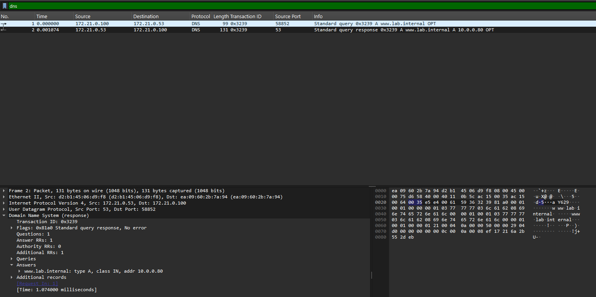
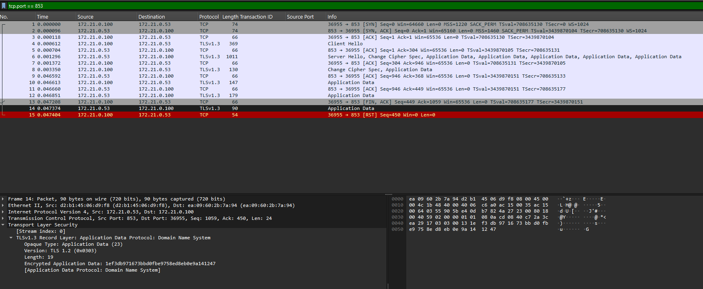
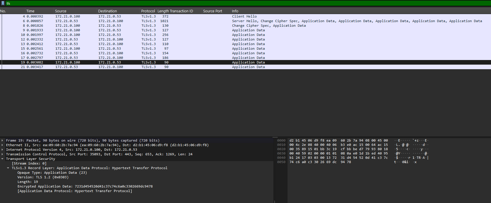
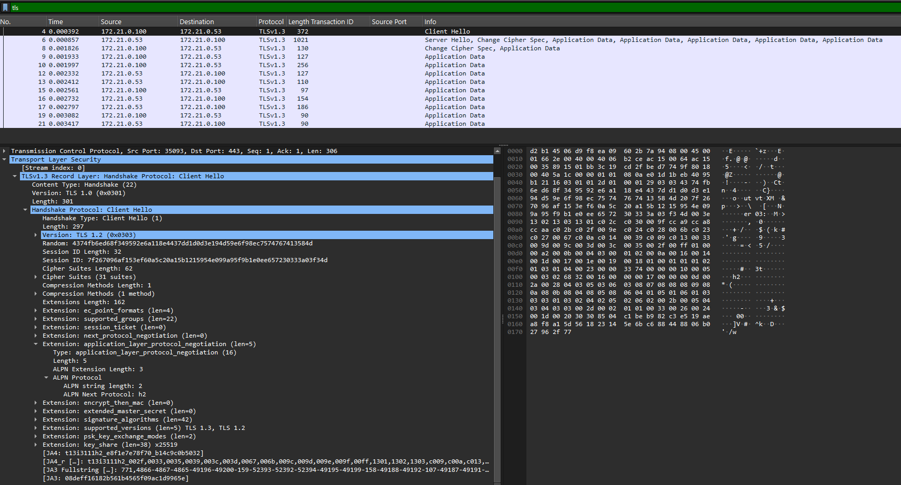

# Issue #6: Módulo 4, DoT e DoH com capturas no Wireshark

Máquina: Windows 11 Home, PowerShell, Docker Desktop 29.9.3.
Data: 27/11/2026 (horário dos contêineres em UTC).

Os comandos com várias linhas foram rodados dentro do `cliente-a` com
`docker compose exec -T cliente-a bash -s`, passando o script pela entrada padrão.
Na gravação, é só entrar com `docker compose exec cliente-a bash` e digitar os mesmos comandos.

## O que muda entre os três protocolos (para ler antes das saídas)

| | DNS comum (Do53) | DNS over TLS (DoT) | DNS over HTTPS (DoH) |
| --- | --- | --- | --- |
| Transporte | UDP, porta 53 | TCP + TLS, porta 853 | TCP + TLS + HTTP/2, porta 443 |
| Quem está no caminho vê | a pergunta e a resposta inteiras | que é DNS (pela porta), mas não o quê | parece um site HTTPS qualquer |
| Protege contra | nada | espionagem e alteração **no caminho** até a borda | idem, e ainda se mistura com a navegação |

O TLS cifra o **canal** entre o cliente e a borda. Ele não diz nada sobre se a **resposta** é
verdadeira: isso continua sendo papel do DNSSEC. A seção 4 mostra essa diferença na prática.

## 1. `dig +tls` e `dig +https` funcionando

```bash
dig @172.21.0.53 +tls www.lab.internal
```

```
; <<>> DiG 9.18.49-1~deb12u3-Debian <<>> @172.21.0.53 +tls www.lab.internal
; (1 server found)
;; global options: +cmd
;; Got answer:
;; ->>HEADER<<- opcode: QUERY, status: NOERROR, id: 19768
;; flags: qr rd ra ad; QUERY: 1, ANSWER: 1, AUTHORITY: 0, ADDITIONAL: 1

;; OPT PSEUDOSECTION:
; EDNS: version: 0, flags:; udp: 1232
; COOKIE: a8e6bf5408176dd4 (echoed)
;; QUESTION SECTION:
;www.lab.internal.		IN	A

;; ANSWER SECTION:
www.lab.internal.	300	IN	A	10.0.0.80

;; Query time: 51 msec
;; SERVER: 172.21.0.53#853(172.21.0.53) (TLS)
;; WHEN: Fri Nov 27 01:06:48 UTC 2026
;; MSG SIZE  rcvd: 89
```

```bash
dig @172.21.0.53 +https www.lab.internal
```

```
; <<>> DiG 9.18.49-1~deb12u3-Debian <<>> @172.21.0.53 +https www.lab.internal
; (1 server found)
;; global options: +cmd
;; Got answer:
;; ->>HEADER<<- opcode: QUERY, status: NOERROR, id: 31389
;; flags: qr rd ra ad; QUERY: 1, ANSWER: 1, AUTHORITY: 0, ADDITIONAL: 1

;; OPT PSEUDOSECTION:
; EDNS: version: 0, flags:; udp: 1232
; COOKIE: dc75ef9f11e78604 (echoed)
;; QUESTION SECTION:
;www.lab.internal.		IN	A

;; ANSWER SECTION:
www.lab.internal.	300	IN	A	10.0.0.80

;; Query time: 3 msec
;; SERVER: 172.21.0.53#443(172.21.0.53) (HTTPS)
;; WHEN: Fri Nov 27 01:06:48 UTC 2026
;; MSG SIZE  rcvd: 89
```

A resposta é a mesma do DNS comum (10.0.0.80, com `ad`), mas a linha `SERVER` mostra que ela
veio pela porta **853 (TLS)** no primeiro caso e pela **443 (HTTPS)** no segundo. Para quem
pergunta, nada muda: o que muda é o "envelope" em que a pergunta viaja.

### Extra: o certificado da borda

O certificado criado pelo `gerar_certificado.sh` é **autoassinado**, e o `dig +tls` por padrão
cifra o canal sem conferir quem está do outro lado. Dá para pedir a conferência:

```bash
dig @172.21.0.53 +tls +tls-ca=/lab/borda/certs/cert.pem +tls-hostname=dns.lab.internal www.lab.internal +short
dig @172.21.0.53 +tls +tls-ca=/lab/borda/certs/cert.pem +tls-hostname=banco.exemplo.com www.lab.internal +short +tries=1 +time=3
dig @172.21.0.53 +tls +tls-ca www.lab.internal +short +tries=1 +time=3
```

```
10.0.0.80
;; TLS peer certificate verification for 172.21.0.53#853 failed: hostname mismatch
;; TLS peer certificate verification for 172.21.0.53#853 failed: self-signed certificate
```

Quando o cliente confia no certificado da borda e espera o nome certo (`dns.lab.internal`), a
consulta funciona. Com o nome errado, ou usando só as autoridades certificadoras do sistema
(que não conhecem um certificado autoassinado), o `dig` recusa a conexão. Isso mostra que a
cifra sozinha não basta: sem conferir o certificado, um intermediário poderia se passar pela
borda. Os navegadores, quando usam DoH, conferem o certificado como em qualquer site HTTPS.
No laboratório, o `dig` funciona com o certificado autoassinado porque, por padrão, não confere.

## 2. Capturas `do53.pcap`, `dot.pcap` e `doh.pcap`

Mesmo laço da etapa 4 do `scripts/demo.sh`: para cada protocolo, liga o `tcpdump` no
`cliente-a`, faz uma consulta e desliga.

```bash
LAB=/lab; B=172.21.0.53; IFACE=eth0
for proto in do53 dot doh; do
    case $proto in
        do53) porta=53;  opt="";;
        dot)  porta=853; opt="+tls";;
        doh)  porta=443; opt="+https";;
    esac
    tcpdump -i "$IFACE" -w "$LAB/capturas/$proto.pcap" "port $porta" >/dev/null 2>&1 &
    PID=$!; sleep 1
    dig @$B $opt www.lab.internal +short
    sleep 1; kill $PID 2>/dev/null; wait $PID 2>/dev/null
done
ls -l $LAB/capturas/*.pcap
for p in do53 dot doh; do echo "$p.pcap: $(tcpdump -nr $LAB/capturas/$p.pcap 2>/dev/null | wc -l) pacotes"; done
```

```
$ dig @172.21.0.53  www.lab.internal +short
10.0.0.80
$ dig @172.21.0.53 +tls www.lab.internal +short
10.0.0.80
$ dig @172.21.0.53 +https www.lab.internal +short
10.0.0.80

-rw-r--r-- 1 tcpdump tcpdump   286 Nov 27 01:07 /lab/capturas/do53.pcap
-rw-r--r-- 1 tcpdump tcpdump  3800 Nov 27 01:07 /lab/capturas/doh.pcap
-rw-r--r-- 1 tcpdump tcpdump  2788 Nov 27 01:07 /lab/capturas/dot.pcap
-rw-r--r-- 1 tcpdump tcpdump 11283 Nov 27 01:02 /lab/capturas/resolvedor.pcap
do53.pcap: 2 pacotes
dot.pcap: 15 pacotes
doh.pcap: 22 pacotes
```

A mesma pergunta custou **2 pacotes** no DNS comum, **15 no DoT** e **22 no DoH**. Os pacotes
a mais são a abertura da conexão TCP, a negociação do TLS e, no DoH, o HTTP/2. Os arquivos
ficam só na sua máquina, em `capturas/`, porque o `.gitignore` não deixa `.pcap` subir.

### O que um observador da rede vê

**DNS comum:**

```bash
tcpdump -nr /lab/capturas/do53.pcap -A
```

```
01:06:59.078874 IP 172.21.0.100.58852 > 172.21.0.53.53: 12857+ [1au] A? www.lab.internal. (57)
E..U....@......d...5...5.AY.29. .........www.lab.internal.......).........
....!j+U-.
01:06:59.079948 IP 172.21.0.53.53 > 172.21.0.100.58852: 12857$ 1/0/1 A 10.0.0.80 (89)
E..u.X@.@..\...5...d.5...aY629...........www.lab.internal......www.lab.internal........!..
..P..).........
....!j+U-.
```

Os 2 pacotes trazem tudo à vista: quem perguntou (172.21.0.100), **o nome** (`www.lab.internal`)
e **a resposta** (`A 10.0.0.80`). Com `-A`, o `tcpdump` mostra os bytes como texto, e o nome
aparece escrito dentro do pacote. Qualquer um no caminho (o Wi-Fi do café, o provedor) lê isso.

**DoT:**

```bash
tcpdump -nr /lab/capturas/dot.pcap
```

```
01:07:01.141176 IP 172.21.0.100.36955 > 172.21.0.53.853: Flags [S], seq 1244078398, win 64660, options [mss 1220,sackOK,TS val 708635130 ecr 0,nop,wscale 10], length 0
01:07:01.141272 IP 172.21.0.53.853 > 172.21.0.100.36955: Flags [S.], seq 3826103135, ack 1244078399, win 65160, options [mss 1460,sackOK,TS val 3439870104 ecr 708635130,nop,wscale 10], length 0
01:07:01.141294 IP 172.21.0.100.36955 > 172.21.0.53.853: Flags [.], ack 1, win 64, options [nop,nop,TS val 708635130 ecr 3439870104], length 0
01:07:01.141788 IP 172.21.0.100.36955 > 172.21.0.53.853: Flags [P.], seq 1:304, ack 1, win 64, options [nop,nop,TS val 708635131 ecr 3439870104], length 303
01:07:01.141880 IP 172.21.0.53.853 > 172.21.0.100.36955: Flags [.], ack 304, win 64, options [nop,nop,TS val 3439870105 ecr 708635131], length 0
01:07:01.142472 IP 172.21.0.53.853 > 172.21.0.100.36955: Flags [P.], seq 1:946, ack 304, win 64, options [nop,nop,TS val 3439870105 ecr 708635131], length 945
01:07:01.142548 IP 172.21.0.100.36955 > 172.21.0.53.853: Flags [.], ack 946, win 64, options [nop,nop,TS val 708635131 ecr 3439870105], length 0
01:07:01.144526 IP 172.21.0.100.36955 > 172.21.0.53.853: Flags [P.], seq 304:368, ack 946, win 64, options [nop,nop,TS val 708635133 ecr 3439870105], length 64
01:07:01.187768 IP 172.21.0.53.853 > 172.21.0.100.36955: Flags [.], ack 368, win 64, options [nop,nop,TS val 3439870151 ecr 708635133], length 0
01:07:01.187789 IP 172.21.0.100.36955 > 172.21.0.53.853: Flags [P.], seq 368:449, ack 946, win 64, options [nop,nop,TS val 708635177 ecr 3439870151], length 81
01:07:01.187836 IP 172.21.0.53.853 > 172.21.0.100.36955: Flags [.], ack 449, win 64, options [nop,nop,TS val 3439870151 ecr 708635177], length 0
01:07:01.188027 IP 172.21.0.53.853 > 172.21.0.100.36955: Flags [P.], seq 946:1059, ack 449, win 64, options [nop,nop,TS val 3439870151 ecr 708635177], length 113
01:07:01.188384 IP 172.21.0.100.36955 > 172.21.0.53.853: Flags [F.], seq 449, ack 1059, win 64, options [nop,nop,TS val 708635177 ecr 3439870151], length 0
01:07:01.188550 IP 172.21.0.53.853 > 172.21.0.100.36955: Flags [P.], seq 1059:1083, ack 450, win 64, options [nop,nop,TS val 3439870151 ecr 708635177], length 24
01:07:01.188580 IP 172.21.0.100.36955 > 172.21.0.53.853: Flags [R], seq 1244078848, win 0, length 0
```

Só aparecem pacotes TCP para a porta 853, com tamanhos (`length`), mas **nenhum nome**. Os três
primeiros (`[S]`, `[S.]`, `[.]`) são a abertura da conexão TCP. Os de 303 e 945 bytes são a
negociação do TLS (o cliente se apresenta e a borda manda o certificado). A pergunta e a
resposta de verdade são os pacotes cifrados menores, de 81 e 113 bytes. No fim, `[F.]` e `[R]`
fecham a conexão.

**DoH:**

```bash
tcpdump -nr /lab/capturas/doh.pcap
```

```
01:07:03.249458 IP 172.21.0.100.35093 > 172.21.0.53.443: Flags [S], seq 1008323886, win 64660, options [mss 1220,sackOK,TS val 3760004074 ecr 0,nop,wscale 10], length 0
01:07:03.249524 IP 172.21.0.53.443 > 172.21.0.100.35093: Flags [S.], seq 3201791134, ack 1008323887, win 65160, options [mss 1460,sackOK,TS val 1083552033 ecr 3760004074,nop,wscale 10], length 0
01:07:03.249537 IP 172.21.0.100.35093 > 172.21.0.53.443: Flags [.], ack 1, win 64, options [nop,nop,TS val 3760004074 ecr 1083552033], length 0
01:07:03.249850 IP 172.21.0.100.35093 > 172.21.0.53.443: Flags [P.], seq 1:307, ack 1, win 64, options [nop,nop,TS val 3760004075 ecr 1083552033], length 306
01:07:03.249906 IP 172.21.0.53.443 > 172.21.0.100.35093: Flags [.], ack 307, win 64, options [nop,nop,TS val 1083552034 ecr 3760004075], length 0
01:07:03.250315 IP 172.21.0.53.443 > 172.21.0.100.35093: Flags [P.], seq 1:956, ack 307, win 64, options [nop,nop,TS val 1083552034 ecr 3760004075], length 955
01:07:03.250355 IP 172.21.0.100.35093 > 172.21.0.53.443: Flags [.], ack 956, win 64, options [nop,nop,TS val 3760004075 ecr 1083552034], length 0
01:07:03.251284 IP 172.21.0.100.35093 > 172.21.0.53.443: Flags [P.], seq 307:371, ack 956, win 64, options [nop,nop,TS val 3760004076 ecr 1083552034], length 64
01:07:03.251391 IP 172.21.0.100.35093 > 172.21.0.53.443: Flags [P.], seq 371:432, ack 956, win 64, options [nop,nop,TS val 3760004076 ecr 1083552034], length 61
01:07:03.251455 IP 172.21.0.100.35093 > 172.21.0.53.443: Flags [P.], seq 432:622, ack 956, win 64, options [nop,nop,TS val 3760004076 ecr 1083552034], length 190
01:07:03.251458 IP 172.21.0.53.443 > 172.21.0.100.35093: Flags [.], ack 432, win 64, options [nop,nop,TS val 1083552035 ecr 3760004076], length 0
01:07:03.251790 IP 172.21.0.53.443 > 172.21.0.100.35093: Flags [P.], seq 956:1017, ack 622, win 64, options [nop,nop,TS val 1083552036 ecr 3760004076], length 61
01:07:03.251870 IP 172.21.0.53.443 > 172.21.0.100.35093: Flags [P.], seq 1017:1061, ack 622, win 64, options [nop,nop,TS val 1083552036 ecr 3760004076], length 44
01:07:03.251891 IP 172.21.0.100.35093 > 172.21.0.53.443: Flags [.], ack 1061, win 64, options [nop,nop,TS val 3760004077 ecr 1083552036], length 0
01:07:03.252019 IP 172.21.0.100.35093 > 172.21.0.53.443: Flags [P.], seq 622:653, ack 1061, win 64, options [nop,nop,TS val 3760004077 ecr 1083552036], length 31
01:07:03.252190 IP 172.21.0.53.443 > 172.21.0.100.35093: Flags [P.], seq 1061:1149, ack 653, win 64, options [nop,nop,TS val 1083552036 ecr 3760004077], length 88
01:07:03.252255 IP 172.21.0.53.443 > 172.21.0.100.35093: Flags [P.], seq 1149:1269, ack 653, win 64, options [nop,nop,TS val 1083552036 ecr 3760004077], length 120
01:07:03.252283 IP 172.21.0.100.35093 > 172.21.0.53.443: Flags [.], ack 1269, win 64, options [nop,nop,TS val 3760004077 ecr 1083552036], length 0
01:07:03.252540 IP 172.21.0.100.35093 > 172.21.0.53.443: Flags [P.], seq 653:677, ack 1269, win 64, options [nop,nop,TS val 3760004077 ecr 1083552036], length 24
01:07:03.252613 IP 172.21.0.100.35093 > 172.21.0.53.443: Flags [F.], seq 677, ack 1269, win 64, options [nop,nop,TS val 3760004077 ecr 1083552036], length 0
01:07:03.252875 IP 172.21.0.53.443 > 172.21.0.100.35093: Flags [P.], seq 1269:1293, ack 678, win 64, options [nop,nop,TS val 1083552037 ecr 3760004077], length 24
01:07:03.252919 IP 172.21.0.100.35093 > 172.21.0.53.443: Flags [R], seq 1008324564, win 0, length 0
```

É o mesmo desenho do DoT, mas na porta 443, a mesma de qualquer site HTTPS, e com mais
pacotes pequenos, que são as mensagens de controle do HTTP/2 trocadas dentro do túnel cifrado.
Quem olha de fora não consegue distinguir isso de alguém abrindo uma página.

### Prova: procurando o nome dentro dos bytes de cada captura

Para não depender só de olhar a lista, procurei os textos direto nos bytes de cada arquivo.
O `cliente-a` não tem o comando `strings`, então usei Python:

```bash
python3 - <<'EOF'
import re
for p in ("do53", "dot", "doh"):
    d = open(f"/lab/capturas/{p}.pcap", "rb").read()
    achados = {t: d.count(t.encode()) for t in ("www", "lab", "internal", "dns-query", "10.0.0.80")}
    alpn = sorted(set(m.decode() for m in re.findall(rb"(?:\x02h2|\x03dot|\x08http/1\.1)", d)))
    tls13 = d.count(b"\x00\x2b\x00\x02\x03\x04")
    print(f"{p}.pcap ({len(d)} bytes): {achados}  ALPN visivel: {[a[1:] for a in alpn] or '-'}  ServerHello TLS 1.3: {tls13}")
EOF
```

```
do53.pcap (286 bytes): {'www': 3, 'lab': 3, 'internal': 3, 'dns-query': 0, '10.0.0.80': 0}  ALPN visivel: -  ServerHello TLS 1.3: 0
dot.pcap (2788 bytes): {'www': 0, 'lab': 0, 'internal': 0, 'dns-query': 0, '10.0.0.80': 0}  ALPN visivel: ['dot']  ServerHello TLS 1.3: 1
doh.pcap (3800 bytes): {'www': 0, 'lab': 0, 'internal': 0, 'dns-query': 0, '10.0.0.80': 0}  ALPN visivel: ['h2']  ServerHello TLS 1.3: 1
```

O texto `10.0.0.80` deu 0 em todos porque o DNS guarda o endereço como 4 bytes binários, e não
como texto. Procurando esses 4 bytes (`0a 00 00 50`):

```
do53.pcap: bytes 0a 00 00 50 (10.0.0.80 em binario) aparecem 1 vez(es)
dot.pcap: bytes 0a 00 00 50 (10.0.0.80 em binario) aparecem 0 vez(es)
doh.pcap: bytes 0a 00 00 50 (10.0.0.80 em binario) aparecem 0 vez(es)
```

Conclusão: **o nome e a resposta só aparecem no DNS comum.** No DoT e no DoH não há nenhum
`www`, `lab` ou `internal`, nem o caminho `/dns-query` do DoH, nem o IP da resposta. As duas
conexões usam **TLS 1.3**. O que ainda vaza é o **tipo** de serviço: o cliente anuncia em texto
claro o protocolo que quer usar (o ALPN), que é `dot` no DoT e `h2` (HTTP/2) no DoH, e a porta
também entrega isso. Ou seja, o observador sabe que você fez DNS cifrado, mas não sabe o quê.

## 3. Prints do Wireshark: nome visível só no UDP

### DNS comum (`do53.pcap`)



*Os 2 pacotes do DNS comum. O nome `www.lab.internal` e o IP `10.0.0.80` aparecem legíveis
na coluna Info e na resposta aberta (**Answers**). No painel de bytes, à direita, o nome
aparece escrito como texto (`www lab internal`), e o IP está nos bytes `0a 00 00 50`, que são
10.0.0.80 em binário. Qualquer um no caminho lê a pergunta e a resposta.*

### DNS over TLS (`dot.pcap`)



*A mesma pergunta pelo DoT, em **15 pacotes** (filtro `tcp.port == 853`): os 3 primeiros abrem
a conexão TCP (`SYN`, `SYN, ACK`, `ACK`), depois vem o handshake **TLS 1.3** (`Client Hello`,
`Server Hello`), e a pergunta e a resposta viajam como **`Application Data`** cifrado. O pacote
aberto mostra só "Encrypted Application Data", bytes sem sentido. Nenhum nome e nenhum IP de
resposta. O campo "Version: TLS 1.2 (0x0303)" no registro é normal: o TLS 1.3 escreve 1.2 ali
por compatibilidade, e a versão de verdade é negociada dentro do handshake.*

### DNS over HTTPS (`doh.pcap`)



*O DoH tem o mesmo padrão do DoT, mas na **porta 443** (`Dst Port: 443` no pacote aberto), a
mesma dos sites HTTPS. Com o filtro `tls`, aparecem só os 12 registros TLS dos 22 pacotes da
captura. Há mais `Application Data` que no DoT, porque o HTTP/2 troca mensagens de controle
dentro do túnel, e o pacote aberto mostra "Application Data Protocol: Hypertext Transfer
Protocol", também cifrado.*

### O que ainda vaza no DoH (Client Hello)



*O **Client Hello** é a única parte do TLS que vai sem cifra. O que ainda vaza: a **porta 443**
e o **ALPN `h2`** (o cliente avisa que quer falar HTTP/2), que dizem "isto é HTTPS", mas não o
que foi perguntado. O que não vaza: a lista de extensões **não tem `server_name` (SNI)**, porque
o `dig` se conectou direto pelo IP 172.21.0.53. Um navegador que usa DoH pelo nome do servidor
(por exemplo, `cloudflare-dns.com`) mandaria esse nome no SNI, e quem estivesse no caminho
saberia **qual** serviço de DNS você usa, mas ainda não saberia **o que** você perguntou.*

### Como os prints foram feitos

As capturas estão em `C:\Users\jamil\Downloads\lab-dns-moderno\lab-dns-moderno\capturas\`.
No `dot.pcap`, se o Wireshark mostrar só `TCP`, use **Decode As...** com a porta 853 como **TLS**.
Uma prova extra, que não foi capturada: em cada arquivo, **Edit > Find Packet** (`Ctrl+F`),
**String** em **Packet bytes**, procurando `lab.internal`. O Wireshark só encontra no `do53.pcap`,
como a busca em Python da seção 2 já mostrou.

## 4. DoH com a zona quebrada ainda dando SERVFAIL (canal x conteúdo)

Repeti a quebra da issue #2, mas consultando por DoH (e também por DoT). Antes de consultar,
esvaziei os caches, porque cada protocolo da borda tem o seu cache e o banco podia estar guardado:

```bash
bash /lab/scripts/quebrar_zona.sh
```

```
banco.lab.internal agora aponta para 10.6.6.6, com a assinatura antiga.
Espere uns 6 segundos (o autoritativo recarrega a zona) e consulte:
  dig @172.21.0.53 banco.lab.internal +dnssec
```

```powershell
docker compose restart borda resolvedor
```

```
 Container lab-dns-moderno-resolvedor-1 Started
 Container lab-dns-moderno-borda-1 Started
```

Depois de 8 segundos:

```bash
dig @172.21.0.53 +https banco.lab.internal +dnssec
```

```
; <<>> DiG 9.18.49-1~deb12u3-Debian <<>> @172.21.0.53 +https banco.lab.internal +dnssec
; (1 server found)
;; global options: +cmd
;; Got answer:
;; ->>HEADER<<- opcode: QUERY, status: SERVFAIL, id: 55953
;; flags: qr rd ra; QUERY: 1, ANSWER: 0, AUTHORITY: 0, ADDITIONAL: 1

;; OPT PSEUDOSECTION:
; EDNS: version: 0, flags: do; udp: 1232
; COOKIE: da2f1f6a77817bd2 (echoed)
;; QUESTION SECTION:
;banco.lab.internal.		IN	A

;; Query time: 7 msec
;; SERVER: 172.21.0.53#443(172.21.0.53) (HTTPS)
;; WHEN: Fri Nov 27 01:07:49 UTC 2026
;; MSG SIZE  rcvd: 59
```

```bash
dig @172.21.0.53 +https banco.lab.internal +cd +noall +comments +answer
```

```
;; Got answer:
;; ->>HEADER<<- opcode: QUERY, status: NOERROR, id: 7695
;; flags: qr rd ra cd; QUERY: 1, ANSWER: 1, AUTHORITY: 0, ADDITIONAL: 1

;; OPT PSEUDOSECTION:
; EDNS: version: 0, flags:; udp: 1232
; COOKIE: c5fd77e2f9ca3e25 (echoed)
;; ANSWER SECTION:
banco.lab.internal.	10	IN	A	10.6.6.6
```

```bash
dig @172.21.0.53 +tls banco.lab.internal +dnssec +noall +comments +answer | grep -E "status|flags|IN"
```

```
;; ->>HEADER<<- opcode: QUERY, status: SERVFAIL, id: 16706
;; flags: qr rd ra; QUERY: 1, ANSWER: 0, AUTHORITY: 0, ADDITIONAL: 1
; EDNS: version: 0, flags: do; udp: 1232
```

```powershell
docker compose logs --since 1m resolvedor | grep "validation failure"
```

```
resolvedor-1  | [1795741669] unbound[1:0] info: validation failure <banco.lab.internal. A IN>: signature crypto failed from 172.20.0.10
```

Mesmo chegando por um canal cifrado (linha `SERVER ... (HTTPS)`), a resposta
adulterada deu **SERVFAIL**, e com `+cd` o IP falso **10.6.6.6** apareceu, igualzinho ao DNS
comum da issue #2. O DoT também deu SERVFAIL. Isso mostra a diferença entre **canal** e
**conteúdo**: o TLS protegeu o trecho entre o cliente e a borda, mas a mentira foi colocada
**na origem**, no autoritativo, antes de entrar no túnel. Se não houvesse DNSSEC, o DoH
entregaria o 10.6.6.6 com toda a segurança do mundo. Quem detectou a fraude foi o Unbound,
conferindo a assinatura (`signature crypto failed`).

Restaurando:

```bash
bash /lab/scripts/restaurar_zona.sh
sleep 16
dig @172.21.0.53 +https banco.lab.internal +dnssec +noall +comments +answer | grep -E "status|flags|IN"
```

```
Zona reassinada. Em uns 15 segundos (recarga da zona + cache da resposta inválida)
banco.lab.internal volta a responder 10.0.0.43 com a flag ad.
;; ->>HEADER<<- opcode: QUERY, status: NOERROR, id: 20808
;; flags: qr rd ra ad; QUERY: 1, ANSWER: 2, AUTHORITY: 0, ADDITIONAL: 1
; EDNS: version: 0, flags: do; udp: 1232
banco.lab.internal.	300	IN	A	10.0.0.43
banco.lab.internal.	300	IN	RRSIG	A 13 3 300 20271127000754 20261127000754 30805 lab.internal. TwGFEJ4WmaJ7ygeDFTBHpnxDXNcIN2Y8St9QvMvQEmeSHhIz3LNcpU/b sZ9TGRcAHWcDhC5aePfBE2wb3RPeMA==
```

A zona voltou ao normal: 10.0.0.43 com `ad`, agora também pelo DoH.

## Resumo

| Item do checklist | Situação |
| --- | --- |
| `dig +tls` e `dig +https` funcionando | Ok, com teste extra do certificado |
| Capturas `do53.pcap`, `dot.pcap` e `doh.pcap` | Ok (2, 15 e 22 pacotes, ficam só locais) e conferidas byte a byte |
| Prints do Wireshark: nome visível só no UDP | Ok, 4 prints na seção 3 (Do53, DoT, DoH e Client Hello) |
| DoH com a zona quebrada ainda dando SERVFAIL | Ok, também no DoT, com zona restaurada no fim |
