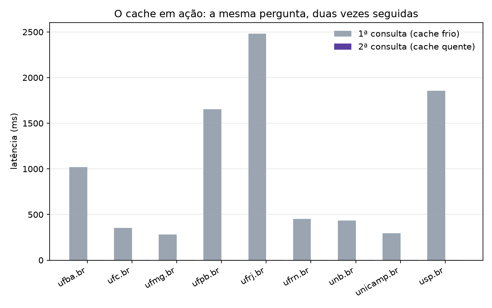
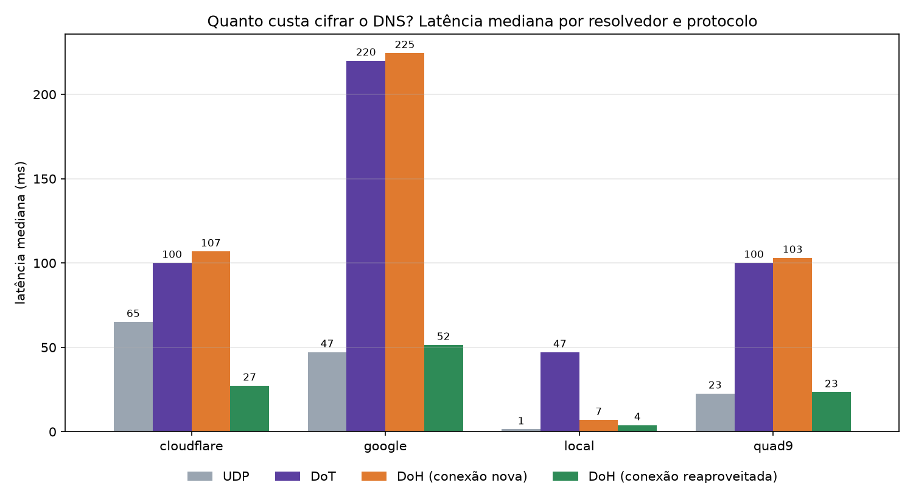

# Issue #9: Módulo 7 — medição e gráficos

Data: 27/11/2026.  
Ambiente: Windows 11, PowerShell no VS Code, Docker Desktop com WSL 2.

## 1. Preparação do ambiente

Foi verificado que os cinco contêineres do laboratório estavam ativos.

Em seguida, os contêineres `borda` e `resolvedor` foram reiniciados para esvaziar os caches antes da medição:

```powershell
docker compose restart borda resolvedor
```

## 2. Teste rápido

Foi executado um teste inicial com três rodadas:

```powershell
docker compose exec -e RODADAS=3 cliente-a python3 /lab/medicao/medir.py
```

Resultado:

```text
rodada 1/3 concluída (80/240 consultas)
rodada 2/3 concluída (160/240 consultas)
rodada 3/3 concluída (240/240 consultas)
Dados salvos em /lab/medicao/dados/medicoes.csv
```

A verificação do CSV confirmou:

```text
True   240
```

As 240 consultas foram bem-sucedidas, sem falhas.

Cada uma das 16 combinações de alvo e protocolo apresentou 15 medições, conforme esperado.

## 3. Identificação dos resolvedores públicos

Foram consultados os registros `id.server` dos resolvedores Cloudflare e Quad9:

```powershell
docker compose exec cliente-a bash -c "dig @1.1.1.1 id.server CH TXT +short"
docker compose exec cliente-a bash -c "dig @9.9.9.9 id.server CH TXT +short"
```

Resultados:

| Resolvedor | Endereço | Identificador |
|---|---|---|
| Cloudflare | 1.1.1.1 | `for01` |
| Quad9 | 9.9.9.9 | `res700.qfor1` |

## 4. Medição completa

Após a aprovação do teste rápido, foi executada a medição com as 30 rodadas previstas:

```powershell
docker compose exec cliente-a python3 /lab/medicao/medir.py
```

O script comparou quatro alvos:

- Borda local;
- Cloudflare;
- Google;
- Quad9.

Foram utilizados quatro protocolos:

- UDP;
- DoT;
- DoH com conexão nova;
- DoH com conexão reaproveitada.

Cada rodada realizou 80 consultas, totalizando 2.400 consultas principais.

Resultado:

```text
rodada 30/30 concluída (2400/2400 consultas)
Dados salvos em /lab/medicao/dados/medicoes.csv
```

A verificação do arquivo confirmou:

```text
True  2400
```

Portanto, todas as 2.400 consultas foram bem-sucedidas.

Cada combinação de alvo e protocolo apresentou 150 medições válidas.

## 5. Análise dos resultados

Foi executado o script de análise:

```powershell
docker compose exec cliente-a python3 /lab/medicao/analisar.py
```

O script calculou a quantidade de medições, a mediana e o percentil 95 (P95) de cada combinação.

### Resultados obtidos

| Alvo | Protocolo | Mediana (ms) | P95 (ms) |
|---|---|---:|---:|
| Local | UDP | 1,4 | 2,5 |
| Local | DoT | 47,1 | 50,2 |
| Local | DoH nova | 7,0 | 61,2 |
| Local | DoH reuso | 3,9 | 8,6 |
| Cloudflare | UDP | 65,1 | 66,6 |
| Cloudflare | DoT | 100,1 | 143,2 |
| Cloudflare | DoH nova | 106,9 | 219,7 |
| Cloudflare | DoH reuso | 27,4 | 120,5 |
| Google | UDP | 47,2 | 89,6 |
| Google | DoT | 220,0 | 249,6 |
| Google | DoH nova | 224,5 | 265,9 |
| Google | DoH reuso | 51,5 | 207,0 |
| Quad9 | UDP | 22,7 | 23,7 |
| Quad9 | DoT | 100,2 | 104,4 |
| Quad9 | DoH nova | 103,1 | 113,4 |
| Quad9 | DoH reuso | 23,4 | 78,7 |

### Observações

- A borda local apresentou as menores medianas de latência, especialmente com UDP (1,4 ms).
- Entre os resolvedores públicos, o Quad9 apresentou a menor mediana no UDP (22,7 ms).
- O reaproveitamento da conexão DoH apresentou medianas menores que o DoH com conexão nova nos quatro alvos.
- O Google apresentou as maiores medianas em DoT e DoH com conexão nova.
- O P95 permite observar o comportamento das consultas mais lentas, complementando a análise da mediana.

## 6. Análise do cache

### Primeira execução (descartada)

Na primeira execução, o `cache.csv` mostrou mediana de **1,5 ms** tanto para o cache frio quanto
para o quente, ou seja, nenhuma diferença. O resultado estava errado por causa da ordem dos passos.

O `medir.py` faz o teste de cache **no começo de cada execução** (a função `main()` chama
`medir_cache()` antes das 2.400 consultas). Os caches foram esvaziados antes do teste rápido
(seção 1), e o teste rápido consultou os 10 nomes do teste de cache. Em seguida, a medição completa
rodou sem um novo `restart`. Quando ela começou, os 10 nomes ainda estavam guardados na borda
(`cache 300`, até 5 minutos) e no Unbound. Assim, a consulta "fria" também saiu da memória, e o
teste comparou cache quente com cache quente.

### Teste de cache refeito

O teste foi refeito em 27/11/2026, a partir das 12:42 UTC, na **máquina da Jamily** (outra rede,
não a mesma da medição principal). Só o teste de cache foi repetido, sem refazer as 2.400 consultas.
Primeiro os caches foram esvaziados; depois a função `medir_cache()` foi chamada sozinha:

```powershell
docker compose restart borda resolvedor
docker compose exec cliente-a python3 -c "import sys; sys.path.insert(0, '/lab/medicao'); import medir; medir.medir_cache()"
docker compose exec cliente-a python3 /lab/medicao/analisar.py
```

Novo `medicao/dados/cache.csv`:

```text
nome,cache,ms
usp.br,frio,1854.47
usp.br,quente,1.55
unicamp.br,frio,292.97
unicamp.br,quente,1.71
ufpe.br,quente,110.89
ufba.br,frio,1020.23
ufba.br,quente,2.07
ufrn.br,frio,453.51
ufrn.br,quente,2.78
ufc.br,frio,351.76
ufc.br,quente,1.99
ufmg.br,frio,281.99
ufmg.br,quente,1.31
unb.br,frio,433.75
unb.br,quente,1.92
ufrj.br,frio,2480.86
ufrj.br,quente,1.23
ufpb.br,frio,1653.5
ufpb.br,quente,2.03
```

Saída do `analisar.py` para o cache:

```text
Cache (mediana em ms):
cache
frio      453.5
quente      2.0
```

Agora a diferença aparece: a primeira consulta de cada nome levou de **282 a 2.481 ms**, porque o
resolvedor precisou buscar a resposta na internet, e a segunda levou de **1,2 a 2,8 ms**, porque
veio da memória (sem contar o `ufpe.br`, explicado abaixo). Nas medianas, são **453,5 ms contra 2,0 ms**.

Uma observação sobre `ufpe.br`: a primeira consulta passou do tempo limite de 3 segundos do
`medir.py` e não foi registrada. Quando a segunda chegou, o resolvedor ainda estava terminando a
busca, e ela levou 110,89 ms. Por isso o `ufpe.br` não aparece no gráfico, e o seu valor "quente"
entra na mediana do cache quente, que tem 10 valores contra 9 do frio.

O `analisar.py` gerou de novo o `cache_frio_quente.png`. O `resumo.csv`, o `medicoes.csv` e o
`mediana_por_protocolo.png` não mudaram.



*As barras cinza são a primeira consulta de cada nome (cache frio). As do cache quente ficam em
torno de 2 ms e, nessa escala, praticamente não aparecem: essa é a diferença que o cache faz.*

## 7. Arquivos gerados

Os arquivos ficam em `medicao/dados/`:

- `medicoes.csv`: as 2.400 consultas da medição completa (rodada, alvo, protocolo, nome, tempo e
  se deu certo).
- `cache.csv`: o teste de cache refeito, com 19 medições (10 nomes, menos a primeira de `ufpe.br`).
- `resumo.csv`: quantidade de medições, mediana e percentil 95 de cada alvo e protocolo.
- `mediana_por_protocolo.png`: gráfico das medianas por alvo e protocolo.
- `cache_frio_quente.png`: gráfico do teste de cache.



## 8. Respostas às 4 perguntas

Todos os números são medianas do `resumo.csv` (medição principal, na rede da Sarah) e do
`cache.csv` (teste de cache refeito, na rede da Jamily).

### 1. Quanto o DoT e o DoH com conexão nova custam a mais que o UDP?

| Alvo | UDP (ms) | DoT (ms) | DoT a mais | DoH nova (ms) | DoH nova a mais |
| --- | ---: | ---: | ---: | ---: | ---: |
| Local (borda) | 1,4 | 47,1 | +45,7 | 7,0 | +5,6 |
| Cloudflare | 65,1 | 100,1 | +35,0 | 106,9 | +41,8 |
| Google | 47,2 | 220,0 | +172,8 | 224,5 | +177,3 |
| Quad9 | 22,7 | 100,2 | +77,5 | 103,1 | +80,4 |

Nos resolvedores públicos, o DoT e o DoH com conexão nova custam de **35 a 177 ms a mais** que o
UDP. O UDP manda a pergunta direto. Com conexão nova, antes da pergunta é preciso abrir a conexão
TCP e negociar o TLS, o que soma idas e voltas pela rede. A diferença varia bastante entre os
provedores, e a medição sozinha não mostra o porquê.

**O caso estranho do DoT na borda local.** Na própria borda, o DoT deu 47,1 ms, enquanto o DoH com
conexão nova, que também abre TCP e TLS, deu só 7,0 ms. A diferença de cerca de 40 ms não é o custo
da criptografia. Ela aparece na captura `dot.pcap` da issue #6 (`modulo-4-dot-doh.md`):

```text
00:00:00.001978 IP 172.21.0.100.36955 > 172.21.0.53.853: Flags [P.], seq 304:368, ... length 64
00:00:00.043242 IP 172.21.0.53.853 > 172.21.0.100.36955: Flags [.], ack 368, ... length 0
00:00:00.000021 IP 172.21.0.100.36955 > 172.21.0.53.853: Flags [P.], seq 368:449, ... length 81
```

(`tcpdump -nr /lab/capturas/dot.pcap -ttt`, pacotes 8 a 10: cada tempo é o intervalo desde o
pacote anterior; as opções TCP de cada linha foram trocadas por `...`.)

O cliente envia o fim do handshake TLS (64 bytes) e depois **espera 43 ms** até o servidor
confirmar o recebimento (o ACK) para só então mandar a pergunta (81 bytes). É o encontro de dois
mecanismos do TCP:

- **Algoritmo de Nagle**, no cliente: enquanto um pacote pequeno não foi confirmado, o próximo
  pacote pequeno fica guardado esperando.
- **ACK atrasado**, no servidor: o servidor não confirma na hora; ele espera algumas dezenas de
  milissegundos para aproveitar e mandar a confirmação junto com uma resposta.

Um fica esperando o outro até o tempo do ACK atrasado acabar. No DoH, isso não acontece: na
captura `doh.pcap`, o cliente manda três pacotes seguidos (64, 61 e 190 bytes) em menos de 0,2 ms,
sem esperar confirmação. Por isso o DoH novo local ficou bem mais rápido.

Uma ressalva: a captura da issue #6 foi feita com o `dig`, e não com o `medir.py`. Não capturamos
o tráfego do `medir.py`. O que dá para dizer é que o atraso de cerca de 40 ms medido aqui bate com
o atraso visto na captura e aparece em toda consulta (o P95 do DoT local é 50,2 ms, bem perto da
mediana).

### 2. Reaproveitar a conexão do DoH chega perto do UDP?

| Alvo | UDP (ms) | DoH reuso (ms) | DoH nova (ms) |
| --- | ---: | ---: | ---: |
| Local (borda) | 1,4 | 3,9 | 7,0 |
| Cloudflare | 65,1 | 27,4 | 106,9 |
| Google | 47,2 | 51,5 | 224,5 |
| Quad9 | 22,7 | 23,4 | 103,1 |

**Sim.** Com a conexão aberta, não há handshake a cada pergunta, e o DoH reaproveitado ficou a
poucos milissegundos do UDP: +2,5 ms na borda, +4,3 ms no Google e +0,7 ms no Quad9. Na Cloudflare,
o DoH reaproveitado (27,4 ms) foi até **mais rápido** que o UDP (65,1 ms). A medição não explica
essa diferença. Ela vale como observação, não como regra.

O P95 do DoH reaproveitado é bem maior que a mediana nos públicos (por exemplo, 120,5 ms na
Cloudflare). A maioria das consultas é rápida, mas algumas ficam lentas.

### 3. Qual a diferença entre cache frio e quente?

No teste refeito, a mediana do **cache frio foi 453,5 ms** e a do **cache quente foi 2,0 ms**,
mais de 200 vezes menos. A primeira consulta de um nome obriga o resolvedor a perguntar à
internet. As seguintes, enquanto o TTL não acaba, saem da memória da borda.

### 4. Qual resolvedor público foi mais rápido daqui, e qual data center respondeu?

No UDP, o **Quad9** foi o mais rápido (**22,7 ms**), seguido do Google (47,2 ms) e da Cloudflare
(65,1 ms). No DoH reaproveitado, o Quad9 também ficou na frente (23,4 ms), com a Cloudflare perto
(27,4 ms). No DoT, Cloudflare (100,1 ms) e Quad9 (100,2 ms) praticamente empataram.

Pelo `id.server` (seção 3), a Cloudflare respondeu de `for01` e o Quad9 de `res700.qfor1`. Os dois
identificadores têm "for", que é o código do aeroporto de Fortaleza. Isso sugere que os dois
responderam de Fortaleza, mas os provedores não documentam esse formato, então é uma leitura do
nome, e não uma confirmação. Esse é o efeito do anycast: o mesmo IP (1.1.1.1 ou 9.9.9.9) é
anunciado em vários lugares, e a rede leva a consulta ao data center mais próximo. O Google não
informa o data center por esse caminho: testado na máquina da Jamily, o
`dig @8.8.8.8 id.server CH TXT` responde `status: SERVFAIL`, sem resposta.

## 9. Como explicar no vídeo

Sugestão de fala, com os dois gráficos na tela:

> Medimos 2.400 consultas: quatro resolvedores, a nossa borda, a Cloudflare, o Google e o Quad9,
> por quatro protocolos. Usamos a mediana, porque uma consulta lenta isolada puxaria a média para
> cima.
>
> Cifrar com conexão nova custa caro: nos resolvedores públicos, o DoT e o DoH novos levaram de
> 35 a 177 milissegundos a mais que o UDP, por causa do handshake TCP e TLS antes da pergunta. Mas,
> reaproveitando a conexão, o DoH ficou a poucos milissegundos do UDP. É o que o navegador faz na
> prática: abre a conexão uma vez e manda várias perguntas.
>
> Um detalhe curioso: na nossa borda, o DoT deu 47 milissegundos e o DoH novo, só 7. Não é a
> criptografia. Na captura, o cliente fica 43 milissegundos parado esperando a confirmação do
> servidor antes de mandar a pergunta. É o algoritmo de Nagle somado ao ACK atrasado do TCP.
>
> O cache faz a maior diferença de todas: na mediana, a primeira consulta levou 453
> milissegundos, e a segunda, 2. E pelo `id.server`, a Cloudflare e o Quad9 responderam de um data center que parece
> ser o de Fortaleza: é o anycast levando a consulta para perto de nós.
